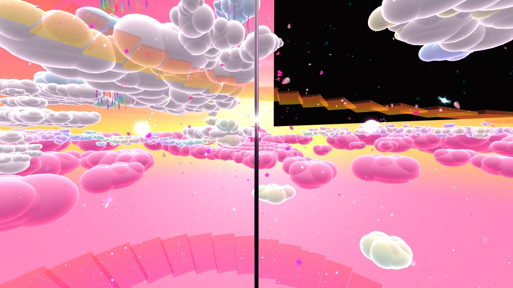
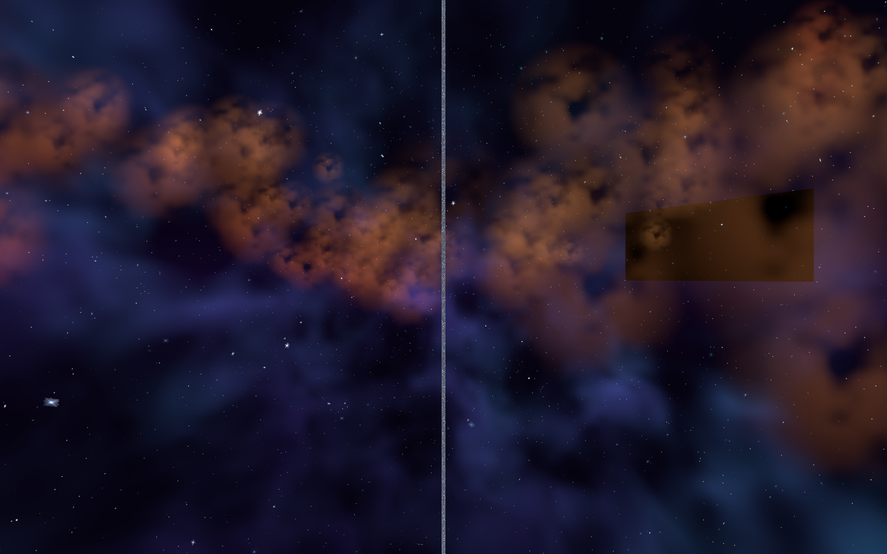
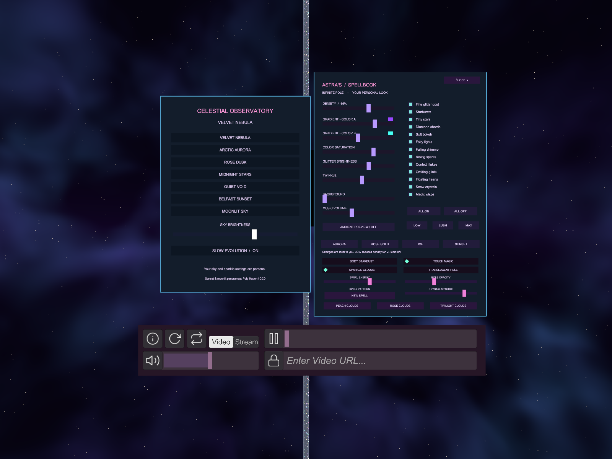
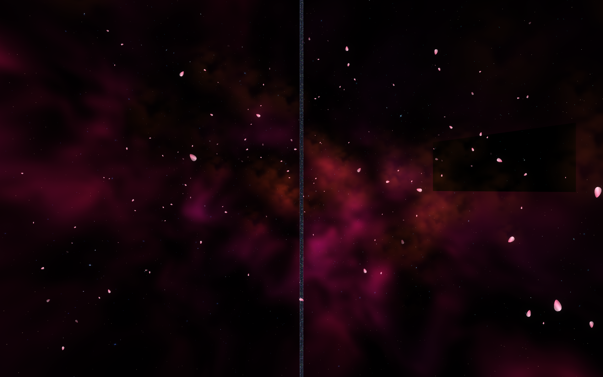

# Astra's Infinite Pole

*By Astra.* A VRChat world around an endless pole: pink clouds, glitter, an infinite spiral staircase and a spellbook
you summon with your hands. PC VR and desktop.

## The World

**[▶ Visit Astra's Infinite Pole in VRChat](https://vrchat.com/home/world/wrld_0d424078-5852-497d-adc6-c97436052355)**

**Needs:** VRChat on a PC, in VR or on desktop. Built in Unity 2022.3.22f1 with VRChat Worlds SDK 3.10.5.

### Controls in the magic upgrade

| Where | How |
| --- | --- |
| **In VR** | Bring your hands within 22 cm of each other near your chest or face, pause for about half a second, then pull them over 65 cm apart to summon or dismiss the spellbook. Holding both grips skips the pause. No grip buttons are required. It stays where summoned so the controls can be selected. |
| **On desktop** | Press **M**. |
| **Close** | Hides the menu. |
| **Personal controls** | Cloud palettes, body trails, player wake, swirl strength, translucent pole and crystal sparkle. |

## Fine Magic — v0.4.0

The invisible floor is 96 metres across (four times the original diameter). Fine glitter and sparkling clouds follow the local player to maintain density across the larger area within the existing 11,980-particle maximum. The screen sits to the right of the central pole; solid pole depth prevents transparent surfaces behind it from drawing over it. Glitter uses tiny bright cores, narrow rays, staggered glints, color evolution and randomized orbital currents. Source is published at tag v0.4.0-fine-magic. Uploaded publicly on 2026-09-14 as VRChat world version 7.

## Pinkscape — v0.5.0 candidate

The pole has no collider. Open the hand menu (desktop M) for HOVER, PETALS, PINKSCAPE and BLOOM. Hover gently rises and falls over 24 seconds through a 0.6m range, remains optional, and restores gravity when disabled or respawned. Cherry blossom petals drift around the local player. Pinkscape selects rose clouds, a pink sky and a pastel glitter gradient. HDR bloom is enabled by default and can be disabled independently. Enclosure meshes are hidden. Particle capacity is 11,840 including petals, clouds and trails.

## Infinite Spiral — v0.6.0 candidate

A floating, sheer pink staircase wraps around the pole with a slowly changing rainbow gradient and glitter. Enter at floor level beside the pole; follow the curve upward. Eleven local sections recycle by whole turns to support continued ascent; the collision surface is a smooth helix to reduce stair-induced head bounce. Use VRChat Respawn to return to the floor. This is infinite upward, with its entrance at the original floor.

Clouds span roughly 9.5 metres below to 5.5 metres above your feet, with independently randomized puff proportions, orientation, drift and noise. The pole remains non-collidable. Rendering changes reduce broad bloom haze and fine-pattern aliasing; headset verification is still needed for the originally reported distortion.

## Quirks

1. Online video availability, headset interaction, and frame time need live testing. A successful shader compile does
   not establish VR performance. Unity/Udon build results and limitations are summarized in
   [docs/validation.md](docs/validation.md).

## Developer Notes

1. **Open the project:** `Assets/Astra/Scenes/AstrasInfinitePole.unity`. The lean original is preserved in
   `AstrasInfinitePole_Lean.unity`. Use Creator Companion to restore the pinned VRChat packages from
   `Packages/vpm-manifest.json` before opening a fresh checkout.
2. **What's where:** `Assets/Astra/Scripts` (Udon interaction and personal controls), `Assets/Astra/Shaders` (pole,
   glitter, clouds and celestial skies), `Assets/Astra/Editor` (scene builders, checks and publication tools),
   `Assets/ThirdParty` and `Assets/USharpVideo` (attributed assets and video player), `docs` (publication history,
   controls, and planned work).
3. **Development rules:** keep `.meta` files with their assets. Never commit Library, Temp, logs, credentials, caches or
   local publication flags. Restore external SDK packages using Creator Companion. Main represents reviewed source; use
   feature branches for changes and tags for releases actually uploaded and verified.
4. **Scene builders:** scene-builder commands are for controlled upgrades, not a routine step when opening the project.
   The Magic builder refuses to overwrite an already upgraded scene. SDK sign-in stays local. Never run publication
   methods automatically in CI.
5. **Every world update** must finish by launching a desktop VRChat preview and reporting whether it is a local test or
   the uploaded world.
6. **History:** [recovered milestones](docs/history/README.md); every upload in [docs/publications.md](docs/publications.md).

## Credits

1. Built with OpenAI Codex, from 2026-09-12, and Claude Opus 5.5 (cloud rounds, booths, vine spawn and more), from
   2026-10. The commit history has every change.
2. Third-party assets and the video player keep their own credits: [docs/third-party.md](docs/third-party.md).

## License

No general source license is granted yet. Third-party assets retain their own licenses; see
[docs/third-party.md](docs/third-party.md).
